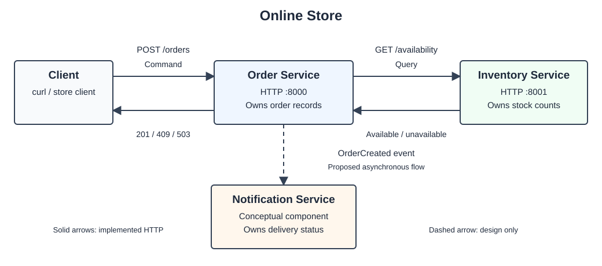

# Online Store

This store accepts orders for one item at a time. It has two Python services: Order handles orders, and Inventory keeps the sample stock counts. They run in separate processes and communicate over HTTP. All data is stored in memory.

## 1. Installing dependencies and running the services

You need Python 3.8+ and curl. Check that both are installed:

```bash
python3 --version
curl --version
```

Install either missing tool using your operating system's installer or package manager. There are no pip dependencies; both services use Python's standard library.

Open two terminals in the repository directory (`cmpe273-online-store`).

Terminal 1:

```bash
python3 inventory_service.py
```

Terminal 2:

```bash
python3 order_service.py
```

Inventory listens on port 8001 and Order on port 8000. Keep both running and use a third terminal for the requests below. Ctrl+C stops a service.

## 2. Architecture diagram



The solid arrows show the working HTTP calls. The dashed arrow shows how Notification would receive an `OrderCreated` event. Notification is part of the design but is not implemented; the assignment requires the Order-to-Inventory call.

## 3. Component responsibilities

| Component | Responsibility |
| --- | --- |
| Order | Validate requests, ask Inventory about availability, and save accepted orders. |
| Inventory | Check whether there is enough stock for a request. |
| Notification (design only) | Notify a user after an order is created. |

## 4. Data ownership

| Component | Data it owns |
| --- | --- |
| Order | Order records: order ID, status, and the item ID and quantity requested. |
| Inventory | Item IDs and stock counts. |
| Notification (design only) | Notification attempts and delivery status. |

## 5. Service boundaries

Inventory decides whether there is enough stock. Order uses that answer to accept or reject the order. Keeping them separate means stock rules can change without changing how orders are stored. Notification has its own responsibility too: a failed notification should be retried without creating another order.

Order waits for Inventory's response because it needs the stock check to finish before answering the client. Notifications could happen afterward, without making the client wait for delivery.

Limits of this design: restarting Order clears its saved orders. Checking availability does not reserve or reduce stock, so repeated orders can exceed the sample stock count. A real store would need a reservation step and a database.

## 6. Commands, queries, and events

| Interaction | From → To | Type | Why |
| --- | --- | --- | --- |
| Check whether an item is available | Order → Inventory | Query | Reads stock without changing it. |
| Create an order | Client → Order | Command | Asks Order to create a new order record. |
| Order was created | Order → Notification (design only) | Event | Reports an order that already exists. |

## 7. Example of a successful request

The sample inventory contains `coffee: 10`, `notebook: 3`, and `pen: 0`.

The curl output in this README was captured during a scripted test. Your order IDs and dates will differ.

Order two coffees:

```bash
curl -i -X POST http://127.0.0.1:8000/orders \
  -H 'Content-Type: application/json' \
  -d '{"item_id":"coffee","quantity":2}'
```

```text
HTTP/1.0 201 Created
Server: BaseHTTP/0.6 Python/3.14.7
Date: Mon, 19 Oct 2026 07:40:24 GMT
Content-Type: application/json
Content-Length: 109

{"order_id": "6c524e37-feeb-43af-ab7e-628dd1023233", "status": "created", "item_id": "coffee", "quantity": 2}
```

## 8. Inventory Service failure test

Press Ctrl+C in the Inventory terminal, leave Order running, and try the coffee request again:

```bash
curl -i -X POST http://127.0.0.1:8000/orders \
  -H 'Content-Type: application/json' \
  -d '{"item_id":"coffee","quantity":2}'
```

Response:

```text
HTTP/1.0 503 Service Unavailable
Server: BaseHTTP/0.6 Python/3.14.7
Date: Mon, 19 Oct 2026 07:40:24 GMT
Content-Type: application/json
Content-Length: 42

{"error": "inventory service unavailable"}
```

Order catches the connection error and returns `503`. Its process stays running. A two-second socket timeout also handles an Inventory service that stops responding.

Start Inventory again with `python3 inventory_service.py` and repeat the request. It returns `201` without restarting Order.

## 9. Output showing the implementation working

### Unavailable item

Pens are out of stock, so this request is rejected:

```bash
curl -i -X POST http://127.0.0.1:8000/orders \
  -H 'Content-Type: application/json' \
  -d '{"item_id":"pen","quantity":2}'
```

Response (extra HTTP headers omitted):

```text
HTTP/1.0 409 Conflict

{"status": "rejected", "reason": "item unavailable", "item_id": "pen", "requested_quantity": 2, "available_quantity": 0}
```

Unknown items are treated as having zero stock, so they also return `409`. A quantity above the stock count returns `409`; invalid input, such as zero or a negative quantity, returns `400`.

### Automated test

Stop both services first so ports 8000 and 8001 are free, then run:

```bash
python3 -m unittest -v test_services
```

The test starts its own service processes and cleans them up afterward. It checks valid and invalid requests, stops Inventory, and submits two more orders. After each `503`, it checks that Order is still running. It then restarts Inventory and checks for a successful order.

Captured test output (the final two lines are printed by the test):

```text
test_order_flow_dependency_failure_and_recovery (test_services.ServiceIntegrationTest.test_order_flow_dependency_failure_and_recovery) ... ok

----------------------------------------------------------------------
Ran 1 test in 0.193s

OK
Inventory stopped: two HTTP 503 responses; Order Service still running.
Inventory restarted: HTTP 201 without restarting Order Service.
```

## 10. Reflection

**Why are clear service boundaries and data ownership important in a distributed architecture?**

Having clear ownership helps avoid confusion between services. For example, if both Order and Inventory keep track of stock, they might end up showing different quantities. To prevent this, Inventory handles all stock information, while Order just checks with Inventory and stores the item ID. This also makes it easier to know where changes should be made. Any changes related to stock go in Inventory, while changes to notifications go in Notification. Since services communicate through APIs or events, they can be updated independently without affecting each other. It also helps when something goes wrong. For example, when Inventory was down, Order was still running and returned a `503` error instead of crashing.
